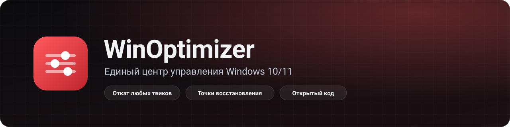

<div align="center">



<br>

**Безопасная оптимизация Windows с откатом, обслуживание, приложения и игровые настройки — в одном окне.**

[](https://github.com/reikidod/WinOptimazer/releases)
[](https://github.com/reikidod/WinOptimazer/actions/workflows/release.yml)
[](https://github.com/reikidod/WinOptimazer/releases)
[](LICENSE)


[**Скачать**](https://github.com/reikidod/WinOptimazer/releases/latest) · [Официальный сайт](https://reikidod.github.io/WinOptimazer-site/) · [Возможности](#-возможности) · [Как пользоваться](#-как-пользоваться) · [Безопасность](#-безопасность) · [Сообщить о проблеме](https://github.com/reikidod/WinOptimazer/issues/new/choose)

</div>

> **Официальный сайт:** [reikidod.github.io/WinOptimazer-site](https://reikidod.github.io/WinOptimazer-site/) — описание возможностей, безопасность и загрузка.

---

> [!NOTE]
> Версия **0.6 Beta**: новая главная панель со снимком состояния ПК, диагностика Windows и локальная история операций. Бета-сборки выходят в ветке `beta` и помечены в релизах как prerelease.

## ✨ Возможности

<table>
<tr>
<td width="50%" valign="top">

### 🏠 Главная панель
Сводка CPU, RAM, системного диска и сети, быстрые переходы, диагностика и последние операции. Показатели автоматически обновляются каждые 2 секунды только пока открыта главная панель.

</td>
<td width="50%" valign="top">

### ⚙️ Оптимизация системы
Каталог твиков реестра и служб с описанием, оценкой пользы и предупреждениями. Каждый твик отменяется. Перед изменениями предлагается точка восстановления. Профили импортируются и экспортируются; загрузка профиля только отмечает твики, не применяя их.

</td>
</tr>
<tr>
<td valign="top">

### 🎮 Игры
Находит игры Steam, Epic, GOG и Xbox, ставит OptiScaler, включает режим высокой производительности GPU.

</td>
<td valign="top">

### 📦 Приложения
Установка, удаление и Microsoft Store в одной группе навигации. Установщики и рекомендуемые файлы проверяются по контрольной сумме.

</td>
</tr>
<tr>
<td valign="top">

### 🧹 Обслуживание
Временные файлы, восстановление системы, автозагрузка (Run, Startup) и планировщик задач Windows. Планировщик работает строго в режиме чтения: показывает скрытые и вложенные задачи, поддерживает поиск по названию, пути, автору и описанию, фильтры по состоянию и категориям. Приложение не включает, не отключает, не запускает, не останавливает, не удаляет и не редактирует задачи Windows. Элементы автозагрузки отключаются обратимо через StartupApproved.

</td>
<td valign="top">

### 🩺 Диагностика и «Мой ПК»
Только чтение: свободное место, нагрузка RAM, сеть, права запуска, ожидающая перезагрузка и температурные датчики. Видеокарта, процессор, память, накопители и система отображаются в разделе «Мой ПК». Температуры NVIDIA читаются через nvidia-smi, если утилита доступна.

</td>
</tr>
</table>

🔄 **Обновления** приложение скачивает само из GitHub Releases: кнопка «Проверить обновления» слева внизу. Перед установкой показывается краткий список изменений.

## 🚀 Как пользоваться

1. Скачайте `WinOptimizer-Setup.exe` или `WinOptimizer-win-x64.zip` из [последнего релиза](../../releases/latest).
2. Запустите `WinOptimizer.exe`. SmartScreen может предупредить о неизвестном издателе: сборка не подписана платным сертификатом, исходники открыты.
3. Откройте **Оптимизация системы**, отметьте нужные твики и нажмите «Применить». Согласитесь на точку восстановления.
4. Если что-то не понравилось, вернитесь в раздел и отмените твик: исходные значения сохранены.

> [!TIP]
> Твики с предупреждением (отключение защиты, служб обновления) включайте осознанно и читайте описание.

### Требования

| | |
|---|---|
| **ОС** | Windows 10 или 11, 64-бит |
| **Среда** | [.NET 8 Desktop Runtime](https://dotnet.microsoft.com/download/dotnet/8.0) (Windows предложит скачать, если её нет) |
| **Права** | Администратор: нужны для твиков HKLM и служб, приложение запросит их при запуске |

## 🔒 Безопасность

- Изменения реестра запоминают прежние значения и отменяются кнопкой.
- Диагностика только читает состояние системы, автоисправлений нет.
- История хранится локально в `%LOCALAPPDATA%\WinOptimizer\history.jsonl`: названия действий и результаты, без содержимого личных файлов.
- Скачиваемые файлы (утилиты и библиотеки) сверяются по SHA-256.
- Игры из Steam/Epic и других лаунчеров не удаляются напрямую, чтобы не снести лаунчер.
- Приложение не отправляет данные о вашем ПК. Логи: `%ProgramData%\WinOptimizer\log.txt`.

Об уязвимостях сообщайте по [SECURITY.md](SECURITY.md).

## ⚠️ Известные ограничения

- Только Windows; на Linux и macOS не запустится.
- OptiScaler нельзя использовать в онлайн-играх с античитом (VAC, EAC, BattlEye): возможен бан.
- Подбор настроек игр по железу пока в разработке.
- Температуры доступны только если Windows или драйвер публикует соответствующий датчик; чтение NVIDIA требует доступного `nvidia-smi`.

## 🤝 Участие

Нашли баг или есть идея? [Создайте issue](https://github.com/reikidod/WinOptimazer/issues/new/choose). Перед PR прогоните тесты: `dotnet test tests/WinOptimizer.Tests/WinOptimizer.Tests.csproj -c Release`.

**Лицензия:** [MIT](LICENSE)

---

<details>
<summary><b>Сборка проекта, тесты, подпись и установщик</b> (для разработчиков)</summary>

## Сборка

```powershell
dotnet build -c Release
dotnet run
```

Иконка: `Assets/app.ico`  
Лицензия копируется в выходную папку вместе с `LICENSE`.

## Windows Defender

Лицензия MIT **не отключает** SmartScreen и Defender. Они смотрят на:

1. **Цифровую подпись** (Authenticode) — самый сильный сигнал  
2. Репутацию файла (сколько людей запуска и без жалоб)  
3. Поведение (запись в реестр, службы, админ-права)

Что можно сделать:

- Собирать **Release** и не путать с вредоносными именами  
- Опубликовать исходники на GitHub (прозрачность)  
- При ложном срабатывании: [Microsoft Security Intelligence](https://www.microsoft.com/en-us/wdsi/filesubmission) → Submit a file  
- Для распространения — подписать exe сертификатом (например, через `signtool` и купленный/облачный код-signing сертификат)

`requireAdministrator` в манифесте нужен для твиков HKLM и служб; из‑за этого SmartScreen строже к «неизвестным» сборкам — это нормально для утилит такого типа.

## Подпись Authenticode

### Важно

| Тип | SmartScreen | Кому подходит |
|-----|-------------|----------------|
| Самоподпись (в комплекте) | Всё равно предупреждает, пока не доверите сертификат вручную | Своя машина / тесты |
| OV/EV Code Signing от CA | Репутация накапливается, предупреждений меньше | Раздача другим людям |

**Бесплатно «как у Microsoft Store» сделать нельзя** — нужен платный code signing сертификат.

### Локальная подпись (самоподпись)

На **Windows** (нужны PowerShell от пользователя и Windows SDK / Visual Studio):

```powershell
# 1. Сертификат + доверие для текущего пользователя
.\scripts\New-CodeSigningCert.ps1

# 2. Сборка + подпись
.\scripts\Sign-Release.ps1
```

Готовый exe: `publish\WinOptimizer.exe`

Пароль PFX по умолчанию: `WinOptimizerLocal`  
Файл: `certs\WinOptimizer-Codesign.pfx`

### Коммерческий сертификат

```powershell
dotnet publish -c Release -r win-x64 -o publish
.\scripts\Sign-WithCommercialCert.ps1 -PfxPath "C:\path\to\real.pfx" -Password "secret"
```

Покупают, например, у SSL.com / Sectigo / DigiCert (Code Signing или EV Code Signing).

### Проверка

```powershell
signtool verify /pa /v publish\WinOptimizer.exe
# или
Get-AuthenticodeSignature publish\WinOptimizer.exe
```


## Установщик (Inno Setup)

Нужны [.NET 8 SDK](https://dotnet.microsoft.com/download) и [Inno Setup 6](https://jrsoftware.org/isdl.php).

```powershell
# одной командой: publish + ISCC
powershell -ExecutionPolicy Bypass -File .\scripts\Build-Installer.ps1
```

Или вручную:

```powershell
dotnet publish -c Release -r win-x64 --self-contained false -o publish
& "${env:ProgramFiles(x86)}\Inno Setup 6\ISCC.exe" .\installer\WinOptimizer.iss
```

Результат: `dist\WinOptimizer-Setup-0.2.0.exe`

Скрипт: `installer\WinOptimizer.iss`  
- x64, права администратора  
- русский / english  
- лицензия MIT  
- ярлык в меню Пуск, опционально на рабочий стол

### Тесты

```powershell
dotnet test tests/WinOptimizer.Tests/WinOptimizer.Tests.csproj -c Release
```

### Автоматические релизы

Push в `beta` запускает тесты, Release-сборку, публикацию, проверку чистой установки и удаления, обновления с предыдущей бета-версии и smoke test, после чего создаётся prerelease `v0.6.<номер сборки>-beta`. Release Notes берутся из соответствующего раздела CHANGELOG. Push в `main` обслуживает стабильный канал; изменения этой бета-ветки не затрагивают `main` до отдельного слияния.

</details>
